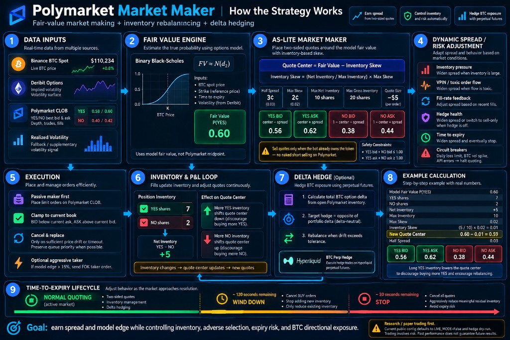

# Polybot — Avellaneda–Stoikov Market Maker for Polymarket BTC Binaries

**English** · [中文](./README.zh-CN.md)

Polybot quotes both sides of Polymarket BTC binary markets. It prices each contract with a Black–Scholes cash-or-nothing formula, posts bids and asks with an Avellaneda–Stoikov inventory skew, and can offset the resulting BTC exposure with a Hyperliquid perpetual. A second quoting policy, a PPO agent trained on the same tick history, is included so the heuristic can be compared with a learned rule on identical data.

The defaults do not send orders. `LIVE_MODE` is `False` and `HEDGE_DRY_RUN` is `True`. Changing either flag sends real orders and can lose money. Read [Safety](#safety) before you change them.

<p align="center">
  
</p>

## Who this is for

Operators and researchers who want a two-sided maker on short-dated Polymarket BTC binaries, with an explicit hedge and a reproducible backtest. You should already be comfortable with limit-order books, binary payoffs, and the risk of leaving an automated process in charge of a funded wallet.

## What the bot trades

Polymarket lists a YES token and a NO token on a question such as whether BTC finishes above a strike. YES pays 1 USDC if the condition is true and 0 otherwise. NO is the complement, so a coherent pair sums to 1 USDC before fees and stale quotes.

The bot watches both tokens on every strike listed in its market file. Inventory is signed YES shares:

```
net inventory = yes_shares − no_shares
```

A long YES position and a short YES position (held as NO shares) pull the quotes in opposite directions.

## How the strategy works

### Fair value

Spot is the Binance BTCUSDT trade stream. Volatility is the Deribit BTC option surface, interpolated to the Polymarket strike. If Deribit is unavailable, a Kalman filter blends the last implied vol with a 60-minute realised vol, starting from the 40% fallback in `config.py`.

The risk-free rate in the code is zero. YES fair value is the cash-or-nothing price:

```
d2 = [ln(S / K) − (σ² / 2) · T] / (σ · √T)
FV = N(d2)
```

`S` is BTC spot, `K` is the strike, `T` is the year-fraction remaining, `σ` is annualised volatility, and `N` is the standard normal CDF. NO fair value is `1 − FV`.

Quotes are centred on this fair value. The Polymarket mid is a market observation and a fill input. It is not the reservation price, because these books are often wide and stale.

### Avellaneda–Stoikov quotes

The production policy is AS-lite, implemented in `strategy/avellaneda_stoikov.py`. A full Poisson-intensity calibration is omitted: on these short-dated books the classical optimal spread collapses onto a one-cent tick. The piece that remains is the inventory skew.

```
skew   = clamp(net_inventory / max_inventory, −1, 1) · skew_max
center = FV − skew
bid    = center − half_spread
ask    = center + half_spread
```

Defaults in `config.py`:

| Parameter | Default | Meaning |
|---|---:|---|
| `MM_HALF_SPREAD_CENTS` | 3 | Half-spread on each side, in cents |
| `MM_SKEW_MAX` | 0.02 | Maximum inventory shift, in dollars, at a full position |
| `MM_MAX_INVENTORY` | 10 | Maximum net shares per market |
| `MM_MAX_GROSS_SHARES` | 20 | Maximum YES + NO shares per market |
| `MM_QUOTE_SIZE_USDC` | 5 | USDC posted on each quote |

NO quotes are the complement of the YES quotes. If YES bid + NO bid would exceed 1, both bids are reduced. If YES ask + NO ask would fall short of 1, both asks are raised. That stops a pair of resting bids from being lifted for a locked-in profit against the bot. The bot also refuses to sell shares it does not hold.

Gross inventory above 70% of the gross cap widens the half-spread, by up to about 3 extra cents at the cap. New bids stop once gross inventory hits the cap.

### Microstructure

`strategy/microstructure.py` widens the half-spread when the book is imbalanced, when short-term momentum is one-sided, or when VPIN flags toxic flow. VPIN here is a 50-trade volume-synchronised measure with a toxicity threshold of 0.35 and a 1.5× penalty.

A separate BTC momentum filter (`MM_MOMENTUM_THRESHOLD = 0.003`, or 0.3%) pulls bids on the side a fast spot move is about to cheapen.

If model edge versus the displayed ask exceeds `MM_TAKER_EDGE_THRESHOLD` (0.15), and the size is at least 5 shares, the bot can cross with a fill-and-kill taker instead of waiting for a maker fill.

### Delta hedge

Each YES share has a binary delta, in BTC per share:

```
Δ = φ(d2) / (S · σ · √T)
```

`φ` is the standard normal density. Because the rate is zero, there is no discount factor. Portfolio delta is the sum of `Δ · (yes_shares − no_shares)` across every strike in the session.

`execution/hedge_manager.py` targets the offsetting BTC perpetual on Hyperliquid. It recalculates every `HEDGE_REBALANCE_INTERVAL` (30 seconds) and sends a clip only when drift exceeds `HEDGE_DELTA_TOLERANCE` (0.002 BTC). Each clip is capped at `HEDGE_MAX_SINGLE_TRADE_BTC` (0.005 BTC) and the whole hedge position at `HEDGE_MAX_POSITION_BTC` (0.05 BTC). Configured leverage is 10× and the market-order slippage bound is 1%.

With `HEDGE_DRY_RUN = True` the manager logs the target and does not send the order. If the live Hyperliquid client fails to start, the hedge falls back to dry-run for that process.

### Time to expiry

Each market moves through three phases:

| Phase | Trigger | What the bot does |
|---|---|---|
| `QUOTING` | More than 120 seconds left | Two-sided quotes |
| `WIND_DOWN` | `MM_WIND_DOWN_SECS` (120s) | Cancels bids and posts no new bids |
| `STOP` | `MM_STOP_SECS` (30s) | Cancels every order. Residual inventory is offered with a fill-and-kill sell |

Resting orders are good-till-date. `MM_ORDER_EXPIRATION_BUFFER` (90 seconds) keeps an order from surviving into settlement.

### Circuit breakers

`strategy/risk_manager.py` can pull every quote:

- Daily PnL, realised plus unrealised, below `MM_MAX_DAILY_LOSS` (−8 USDC). This halt also requests a panic close.
- A BTC move larger than `MM_VOL_SPIKE_THRESHOLD` (2%) inside `MM_VOL_SPIKE_WINDOW` (10 seconds). The halt lasts 30 seconds.
- More than 10 API errors in a rolling minute. The halt lasts 60 seconds.
- Inside the last `MM_MIN_HOURS_TO_EXPIRY` (0.5 hour), quoting stops.

Inside the last 2 hours the spread multiplier rises with time: about 1.5× at 2 hours and about 3× at 0.5 hour. Inventory above 20 shares in that window is marked for a panic close.

The same multiplier also reacts to fills. More than 3 fills per minute widens quotes, up to 2×. Ten minutes with no fill tightens them, down to 0.85×.

### Learned policy, and the legacy sniper

The PPO agent is a research baseline. Its action is a spread tier plus a skew tier. It is trained offline with stable-baselines3 and scored on the same days as AS-lite. `main.py` does not load it.

`MM_ENABLED = False` selects an older single-sided sniper. That path buys when fair value exceeds the ask by `MIN_EDGE` (0.005), sizes with half-Kelly (`KELLY_FRACTION = 0.5`), and cancel-replaces an order that sits longer than `ORDER_TIMEOUT_SECONDS` (30). The market-maker loop is the default.

## What happens at startup

`main.py` reads `data/best_markets.json`, rebuilds share inventory by replaying the trade journal, and opens four public feeds:

| Feed | Role |
|---|---|
| Binance `btcusdt` websocket | Underlying price |
| Binance USD-M premium index | BTC perpetual funding, polled every 60 seconds and stored as a feature |
| Polymarket CLOB websocket | YES book always; NO book as well while market-making is on |
| Deribit BTC options websocket | Implied-vol surface, `VOL_SURFACE_STRIKES` (5) strikes around the money |

Each cycle then:

1. Recomputes fair value from spot, strike, time left, and volatility.
2. Asks the risk manager whether quoting is allowed, and which spread multiplier to apply.
3. Builds up to four quotes.
4. Cancel-replaces any live order that has drifted more than `MM_ORDER_TOLERANCE_TICKS` (2), and forces a refresh every `MM_REQUOTE_INTERVAL` (5 seconds).
5. Polls fills every `MM_POLL_FILLS_INTERVAL` (10 seconds) and updates share counts and VWAP cost.
6. Recomputes portfolio delta. A live hedge sends the Hyperliquid clip from a background thread so the synchronous SDK does not block the event loop.

In live mode the quote manager cancels every open order before the first quote, so a restart does not leave the previous process’s orders working.

With `LIVE_MODE = False`, quotes stay local. Fills are simulated with `SIM_FILL_MODEL = "stochastic"`, checked every second, and appended to the trade journal when `SIM_FILL_LOG_TO_CSV` is true.

## Repository layout

### `strategy/`

| File | Role |
|---|---|
| `avellaneda_stoikov.py` | AS-lite bid, ask, skew, and the YES/NO arbitrage clamp |
| `pricing.py` | Binary fair value `N(d2)`, strike interpolation of the vol surface, half-Kelly size |
| `microstructure.py` | Book imbalance, momentum, spread shape, VPIN |
| `binary_delta.py` | Per-share and portfolio delta |
| `realized_vol.py` | Realised-vol window and the Kalman blend with implied vol |
| `risk_manager.py` | Loss halt, vol-spike halt, expiry multiplier, API-error pause |
| `state.py`, `fill_model.py` | Shared backtest state and the simulated fill probabilities |

### `connectors/`

| File | Role |
|---|---|
| `poly_ws.py` | Polymarket CLOB websocket: book and trades |
| `binance_ws.py` | Binance BTC spot |
| `deribit_ws.py` | Deribit BTC option implied vol |
| `hyperliquid_client.py` | Hyperliquid info and exchange client for the BTC perpetual |
| `cf_bypass.py` | Replaces the CLOB HTTP helper with a Cloudflare-tolerant client. Imported before `py_clob_client` |

### `execution/`

| File | Role |
|---|---|
| `trader.py` | CLOB authentication, maker price helper, and the legacy sniper |
| `quote_manager.py` | Live two-sided quotes, cancel-replace, fill polling, paper fills |
| `hedge_manager.py` | Delta target, rebalance, position reconcile, hedge journal |

### `tools/`

| File | Role |
|---|---|
| `backtest_comparison.py` | Tick backtest of AS-lite against a PPO policy, plus a filter grid |
| `backtest_AB.py` | Grid over time-varying spreads and regime filters, last 7 days held out |
| `backtest_B_fulltick.py` | Full-tick variant of the regime-filter test |
| `param_optimizer.py` | Optuna search over AS-lite hyperparameters |
| `build_rl_dataset.py` | Audit recorded days and optionally export a master CSV |
| `rl_ppo_train.py` | PPO training on a Gymnasium environment built from those days |
| `rl_quick_test.py` | Short linear Q-learning sanity check against the heuristic |
| `poly_iv_analysis.py` | Backs out Polymarket implied vol and compares it with Deribit |

`main.py` is the live and paper entry point. `config.py` holds every trading parameter.

## Requirements

Python 3.11 or newer. This tree has no pinned `requirements.txt`. The modules import:

- Runtime: `python-dotenv`, `requests`, `httpx`, `websockets`, `py-clob-client`, `curl_cffi`, `eth-account`, `hyperliquid-python-sdk`
- Research: `numpy`, `pandas`, `gymnasium`, `stable-baselines3`, `optuna`

Install them into a virtual environment before importing `main.py`. `connectors/cf_bypass.py` must remain the first import inside `main.py`; the CLOB client patches its HTTP layer at import time.

## Configuration

Parameters live in `config.py`. Secrets are read from the environment. `python-dotenv` loads a local `.env`, which is gitignored.

```bash
POLY_PRIVATE_KEY=
HYPERLIQUID_PRIVATE_KEY=
```

`POLY_PRIVATE_KEY` is the Polygon signer used by the Polymarket CLOB client (chain id 137). A leading `0x` is stripped. The key is used only when `LIVE_MODE` is true. `HYPERLIQUID_PRIVATE_KEY` is read only when hedging is enabled and `HEDGE_DRY_RUN` is false. Leave both empty for a paper session.

### Mode switches

| Flag | Default | Effect when changed |
|---|---|---|
| `MM_ENABLED` | `True` | `False` runs the legacy sniper |
| `LIVE_MODE` | `False` | `True` authenticates and posts CLOB orders |
| `HEDGE_ENABLED` | `True` | `False` skips delta calculation |
| `HEDGE_DRY_RUN` | `True` | `False` sends Hyperliquid orders |
| `MULTI_STRIKE_ENABLED` | `True` | `False` trades only the first market in the file |
| `MICROSTRUCTURE_ENABLED` | `True` | `False` leaves the half-spread unadjusted |
| `VOL_SURFACE_ENABLED` | `True` | `False` uses a single Deribit strike |
| `SIM_FILL_LOG_TO_CSV` | `True` | Paper fills are written into the trade journal |

Price guards used by the sniper, and still present for quote clamping, are `MIN_SAFE_PRICE = 0.05` and `MAX_SAFE_PRICE = 0.95`. Polymarket tick size is 0.01 between 0.10 and 0.90, and 0.001 outside that band.

### Market file

`MARKET_DATA_FILE` points at `data/best_markets.json`. The file is a JSON list. Each object needs:

```json
{
  "question": "Bitcoin above 80000 on …?",
  "strike": 80000,
  "expiry": "2026-04-01T20:00:00Z",
  "yes_id": "<YES token id>",
  "no_id": "<NO token id>"
}
```

`expiry` is an ISO-8601 timestamp. A trailing `Z` is accepted.

`data/` is gitignored. A fresh clone has neither the market file nor `data/recorder.py`. `main.py` imports `DataRecorder` before it checks for the JSON, and that module is unpublished because the journal can contain order ids and fills that trace back to a wallet. Provide your own recorder, with a `trades_file` path the market context can replay, before `python main.py` will start. Research scripts read `data/dataset_2026-*.csv` and exit with an error when that directory is empty.

## Running

Work from the repository root so `import config` and `data/` resolve.

### Backtests and training

These commands only read local CSVs. They do not place orders.

```bash
python tools/backtest_comparison.py --days 10
python tools/backtest_comparison.py --days 10 --model path/to/model.zip
python tools/backtest_comparison.py --days 10 --grid
python tools/backtest_AB.py
python tools/backtest_B_fulltick.py
python tools/param_optimizer.py --days 25 --n_trials 60
python tools/build_rl_dataset.py --days 30 --export
python tools/rl_quick_test.py --days 5 --episodes 200
python tools/rl_ppo_train.py --days 15 --steps 100000 --oos 3
python tools/poly_iv_analysis.py
```

`param_optimizer.py --apply` rewrites `config.py` when the out-of-sample score clears its gate. Read that diff before a live session. `backtest_AB.py` trains on the earlier days and scores the last 7. `rl_ppo_train.py` reserves the last `--oos` days (default 3) for evaluation. Weights go to `rl_models/`, which is gitignored.

### Paper session

With `data/recorder.py`, `data/best_markets.json`, and the defaults in `config.py`:

```bash
python main.py
```

The banner is `POLYBOT v3`, followed by each market question and strike. The hedge line should say `dry-run`. Ctrl+C cancels the feed tasks and closes the loop. No private key is required in this mode.

### Live session

Set `LIVE_MODE = True` only when you intend the process to post orders with `POLY_PRIVATE_KEY`. Set `HEDGE_DRY_RUN = False` only when you also intend Hyperliquid perpetual orders, at the size and leverage in `config.py`. Fund the Polymarket wallet and the Hyperliquid account separately. The process has no confirmation prompt. On a clean start you should see the CLOB authentication line and `Cancel-all au démarrage` before any new quote.

Cross-strike exposure is scaled by `MM_CROSS_STRIKE_MULT` (1.2) on gross inventory and `MM_CROSS_DIRECTIONAL_MULT` (0.8) on directional inventory, so several strikes cannot each run to their per-market cap at once.

## Indicative backtest

Historical ticks, in-sample, about 5 USDC per quote and a max inventory of 10 shares:

| Policy | Average PnL / day | Reading |
|---|---:|---|
| AS-lite heuristic | ~+44 USDC | Production policy |
| PPO agent | ~+54 USDC | About +22% versus the heuristic on the same sample |

These are simulated in-sample results. They are not a live track record. A gap of this size usually narrows on a strict holdout. Use `tools/backtest_AB.py` and `tools/rl_ppo_train.py --oos` before treating either number as evidence.

## Left out of this tree on purpose

| Path | Why it is absent |
|---|---|
| `data/` | Recorded books and the trade journal. Fills can be tied to a wallet on-chain. |
| `results/` | Outputs from real strategy runs |
| `.env` | Polymarket and Hyperliquid private keys |
| `*.pem` | SSH key for a production host |
| `rl_models/` | Trained weights |

`.gitignore` already excludes them. Record your own days, fill in your own `.env`, and point the tools at that data.

## Safety

- The published defaults simulate Polymarket fills and log hedges. They do not post either.
- Live mode can buy, sell, and, inside the last 30 seconds, send fill-and-kill orders to flatten.
- A live hedge uses the leverage and market-order slippage in `config.py` (10× and 1% in the current file). A hedge that does not fill leaves the option inventory directional.
- The −8 USDC daily halt covers realised plus unrealised PnL inside this process. It does not cover exchange downtime, a disputed resolution, or a leaked key.
- Do not commit `.env`, journals, PEM files, or model weights.
- The software is MIT-licensed and is provided without warranty. You are responsible for every order it sends.

## Status

This started as a personal research project on market making where a binary option meets a crypto underlying. A live deployment ran on AWS for several weeks in early 2026. The copy in this repository is the backtesting and iteration sandbox.

## License

MIT. See [LICENSE](LICENSE).
